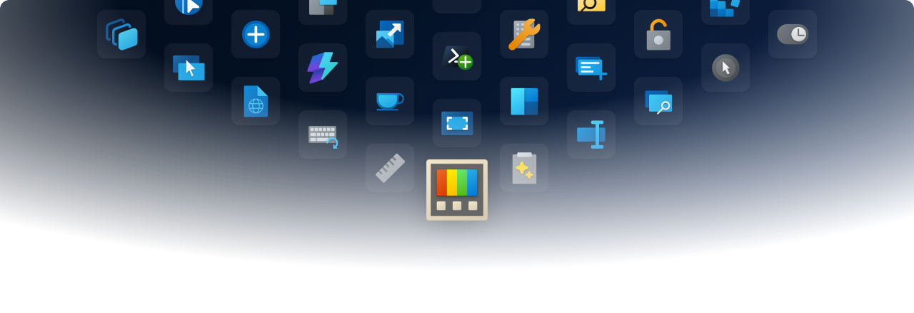
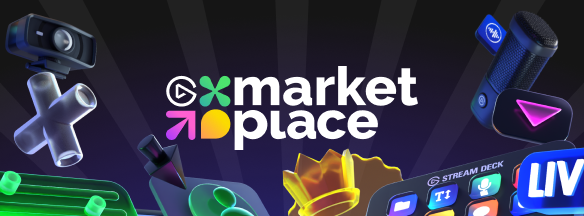

    <picture>
      <source media="(prefers-color-scheme: light)" srcset="./.github/pt-hero.light.png" />
      
  </picture>

<h1 align="center">
  Microsoft PowerToys Icons
</h1>

  A collection of PowerToys icons for the Elgato Stream Deck

<h3 align="center">
  <a href="#installation">Installation</a>
   · 
  <a href="#changelog">Changelog</a>
</h3>

## Installation

To get started, choose a method below.

<strong>Download the .streamDeckIconPack file from GitHub</strong>

 

1. Go to the [latest release](https://github.com/KilLo445/sdPowerToys/releases/latest), scroll down and select **Assets** to reveal the installation files, and download com.killo.powertoys.streamDeckIconPack

2. Double-clicking the .streamDeckIconPack file should automatically open the Elgato Stream Deck software and install the icon pack.

<strong>Elgato Marketplace (Coming Soon)</strong>

 
You can easily install the icon pack from the Elgato Marketplace:
 
 

  <a style="text-decoration:none" href="">
    <picture>
      
  </picture></a>

## Changelog

To see the changelog, check out the [releases](https://github.com/KilLo445/sdPowerToys/releases).

*Read Me is heavily based on the original [PowerToys](https://github.com/microsoft/PowerToys).*